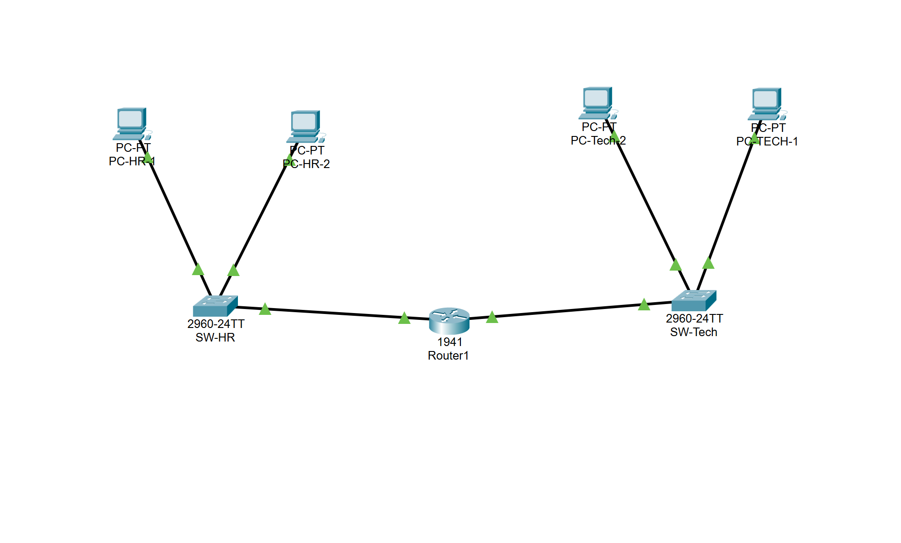
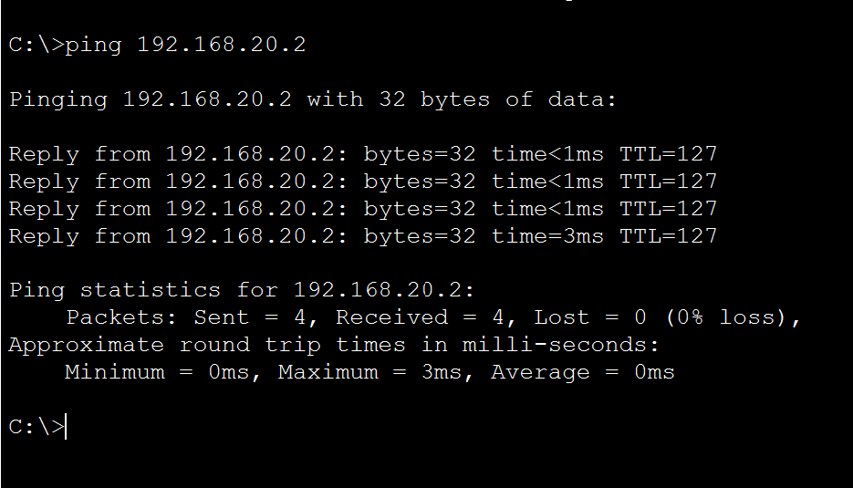
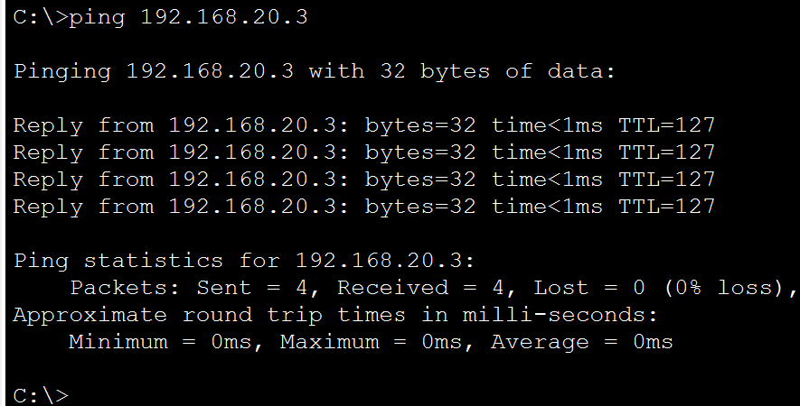
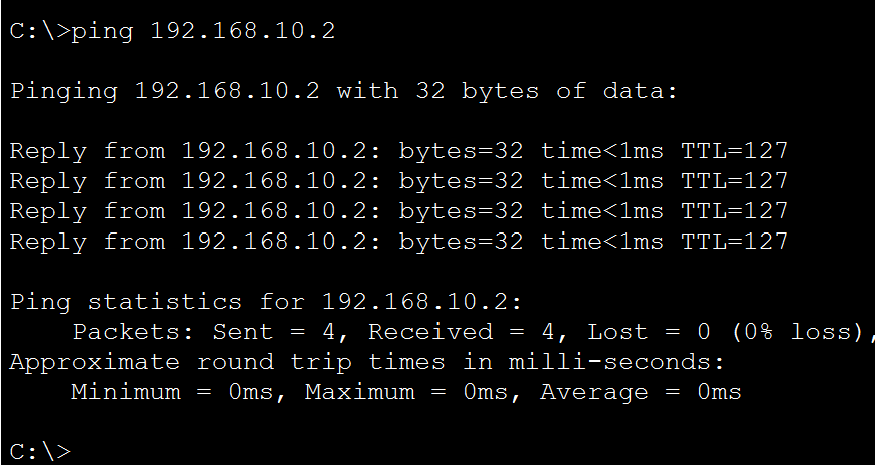
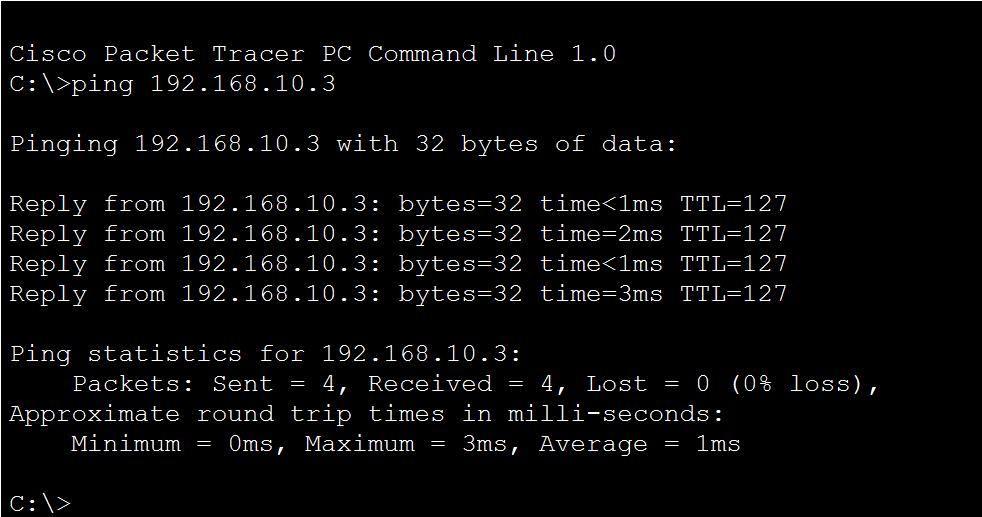

# Level 1 Networking — Inter-Subnet Routing

## Topology



The network has two separate subnets, HR and Tech, with one switch and two PCs in each department. Router1 connects both networks and allows devices on one subnet to communicate with devices on the other.

## IP Addressing

| Device | Subnet | IP Address | Subnet Mask | Default Gateway |
|---|---|---|---|---|
| PC-HR-1 | HR | `192.168.10.2` | `255.255.255.0` | `192.168.10.1` |
| PC-HR-2 | HR | `192.168.10.3` | `255.255.255.0` | `192.168.10.1` |
| PC-Tech-1 | Tech | `192.168.20.2` | `255.255.255.0` | `192.168.20.1` |
| PC-Tech-2 | Tech | `192.168.20.3` | `255.255.255.0` | `192.168.20.1` |

HR uses `192.168.10.0/24`, and Tech uses `192.168.20.0/24`.

All PCs were assigned static IP addresses. The router interface on each subnet is set as that subnet's default gateway.

## Router Configuration

Router1 handles routing between the two subnets.

- `GigabitEthernet0/0` — `192.168.10.1/24` — HR
- `GigabitEthernet0/1` — `192.168.20.1/24` — Tech

The router interfaces were configured with their IP addresses and enabled using `no shutdown`.

Commands used:

```text
enable
configure terminal

interface gigabitEthernet0/0
 ip address 192.168.10.1 255.255.255.0
 no shutdown
exit

interface gigabitEthernet0/1
 ip address 192.168.20.1 255.255.255.0
 no shutdown
exit

end
write memory
```

Both networks are directly connected to Router1, so no additional static routes were required.

## Connectivity Testing

The following screenshots show the ping tests performed from each PC.

### PC-HR-1



### PC-HR-2



### PC-Tech-1



### PC-Tech-2



The ping tests confirmed that devices in HR and Tech can communicate through Router1. Successful cross-subnet ping tests showed 0% packet loss.

