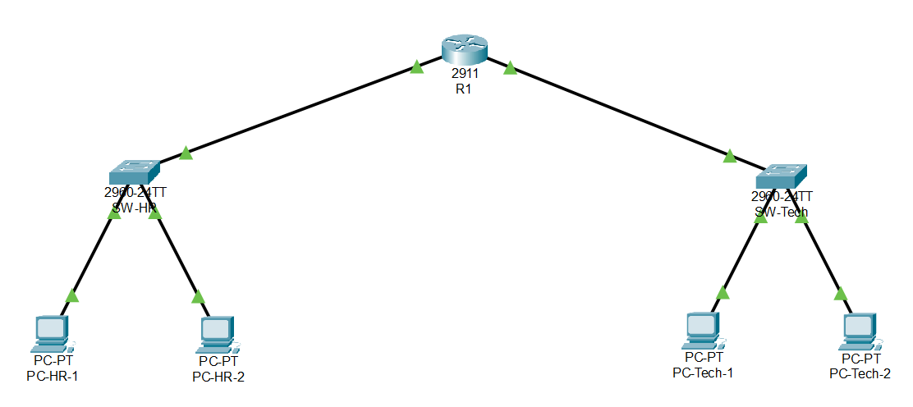
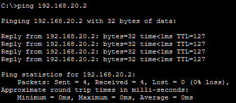
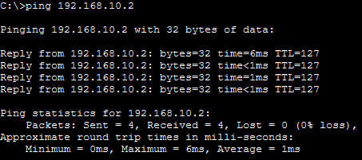

# Level 1 - Inter-Subnet Office Networking

## Topology

I built a network with 4 PCs, 2 switches and 1 router. Each PC connects to its department’s switch and each switch connects to its own router interface using copper straight-through cables.

## IP Addressing Table
| Device | Subnet | IP Address | Subnet Mask | Gateway |
|--------|--------|------------|-------------|---------|
| PC-HR-1 | HR | 192.168.10.2 | 255.255.255.0 | 192.168.10.1 |
| PC-HR-2 | HR | 192.168.10.3 | 255.255.255.0 | 192.168.10.1 |
| PC-Tech-1 | Tech | 192.168.20.2 | 255.255.255.0 | 192.168.20.1 |
| PC-Tech-2 | Tech | 192.168.20.3 | 255.255.255.0 | 192.168.20.1 |
| R1 Gi0/0 | HR | 192.168.10.1 | 255.255.255.0 | N/A |
| R1 Gi0/1 | Tech | 192.168.20.1 | 255.255.255.0 | N/A |

## Router Configuration

1. R1’s GigabitEthernet0/0 interface is connected to SW-HR and has the IP address 192.168.10.1, which serves as the default gateway for the HR subnet. The GigabitEthernet0/1 interface is connected to SW-Tech and has the IP address 192.168.20.1, which serves as the default gateway for the Tech subnet.

2. The `no shutdown` command is used to activate the router’s interfaces. This enables the interfaces to send and receive network traffic. After I ran it, the links to the router turned green from red.

3. Both the HR and Tech networks are directly connected to R1, so router learns them automatically from its interface addresses. No static routes are needed for these networks. Static routes are only needed to reach networks that are not directly connected to the router.

Commands used on R1:
```
enable
configure terminal
hostname R1
interface gigabitEthernet0/0
 ip address 192.168.10.1 255.255.255.0
 no shutdown
 exit
interface gigabitEthernet0/1
 ip address 192.168.20.1 255.255.255.0
 no shutdown
 exit
end
write memory
```

## Ping Results

PC-HR-1 pinged PC-Tech-1 (192.168.20.2). All 4 packets were received, with 0% loss.


PC-Tech-1 pinged PC-HR-1 (192.168.10.2). All 4 packets were received, with 0% loss.