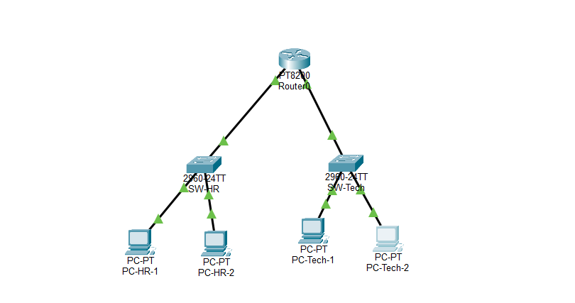
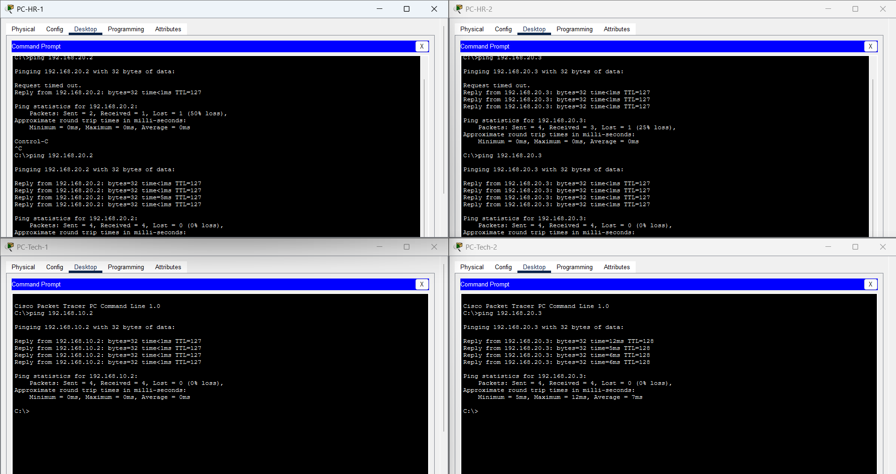

# Level 1 - Inter-Subnet Office Networking

## Topology

The Packet Tracer topology connects two `/24` office subnets through router R1: HR (`192.168.10.0/24`) and Tech (`192.168.20.0/24`).

## IP addressing

| Device | Subnet | IP address | Subnet mask | Default gateway |
|---|---|---|---|---|
| PC-HR-1 | HR | `192.168.10.2` | `255.255.255.0` | `192.168.10.1` |
| PC-HR-2 | HR | `192.168.10.3` | `255.255.255.0` | `192.168.10.1` |
| PC-Tech-1 | Tech | `192.168.20.2` | `255.255.255.0` | `192.168.20.1` |
| PC-Tech-2 | Tech | `192.168.20.3` | `255.255.255.0` | `192.168.20.1` |

## Router configuration

R1 connects to the HR subnet on `GigabitEthernet0/0`, configured as `192.168.10.1/24`, and to Tech on `GigabitEthernet0/1`, configured as `192.168.20.1/24`. Both interfaces were enabled with `no shutdown`. The router has a directly connected route to each subnet, so no additional static routes are needed.

Each PC uses the router interface in its subnet as its default gateway.

## Connectivity verification

The screenshot shows successful pings between the HR and Tech subnets. The first request may time out while ARP resolves; subsequent requests succeed.

## Files

- [Packet Tracer topology](network_topology.pkt)
- [Topology screenshot](topology.png)
- [Ping verification screenshot](pings.png)
