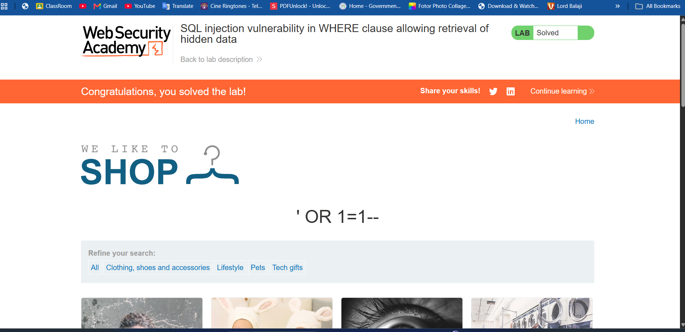
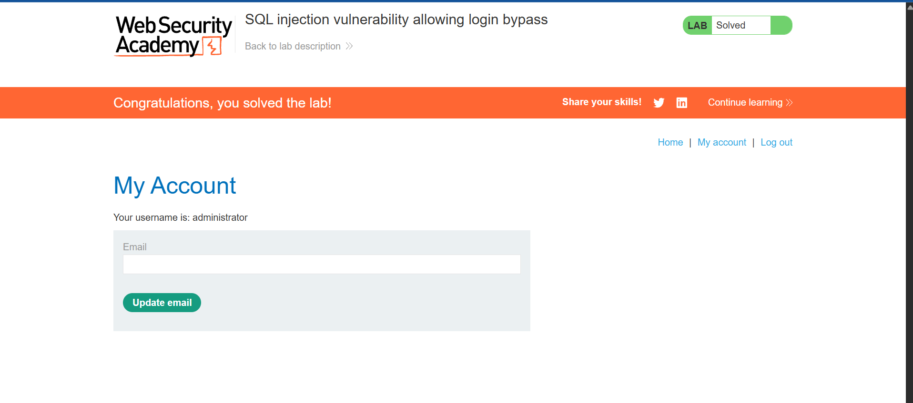
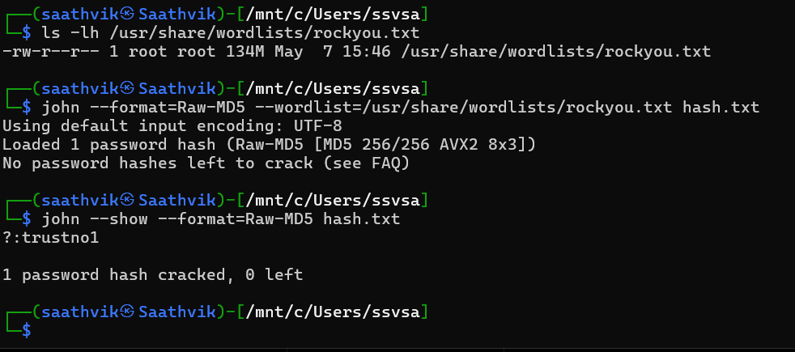

# Cybersecurity Level 3 - PortSwigger SQL Injection Labs

Both exercises were completed on PortSwigger Web Security Academy's designated practice labs.

## Lab 1: Retrieve hidden data

**Lab:** SQL injection vulnerability in WHERE clause allowing retrieval of hidden data  
**Injection point:** `category`

The category parameter included this payload:

```text
' OR 1=1--
```

The quote closes the original string value, `OR 1=1` makes the condition true, and the trailing comment marker removes the rest of the original condition. The solved-lab screenshot shows the product listing after the category filter was bypassed.



## Lab 2: Login bypass

**Lab:** SQL injection vulnerability allowing login bypass  
**Injection point:** username field

The username used was:

```text
administrator'--
```

The quote closes the username string in the query, and the comment marker causes the remainder of the query, including the password condition, to be ignored. The solved-lab screenshot shows the account authenticated as `administrator`.


# Cybersecurity Level 3 - Hash Cracking

## Identify the hash

The supplied hash is `5fcfd41e547a12215b173ff47fdd3739`. Its 32-character hexadecimal form is consistent with MD5, though length alone cannot distinguish MD5 from other algorithms with the same digest format. The captured John the Ripper command uses `Raw-MD5` mode.

## Crack and verify

The screenshot shows this John the Ripper command using `rockyou.txt`:

```bash
john --format=Raw-MD5 --wordlist=/usr/share/wordlists/rockyou.txt hash.txt
```

John reported no hashes left to crack, which indicates this hash was already present in its local pot file. I displayed the stored result with:

```bash
john --show --format=Raw-MD5 hash.txt
```

The output showed:

```text
?:trustno1
```

**Recovered password:** `trustno1`


